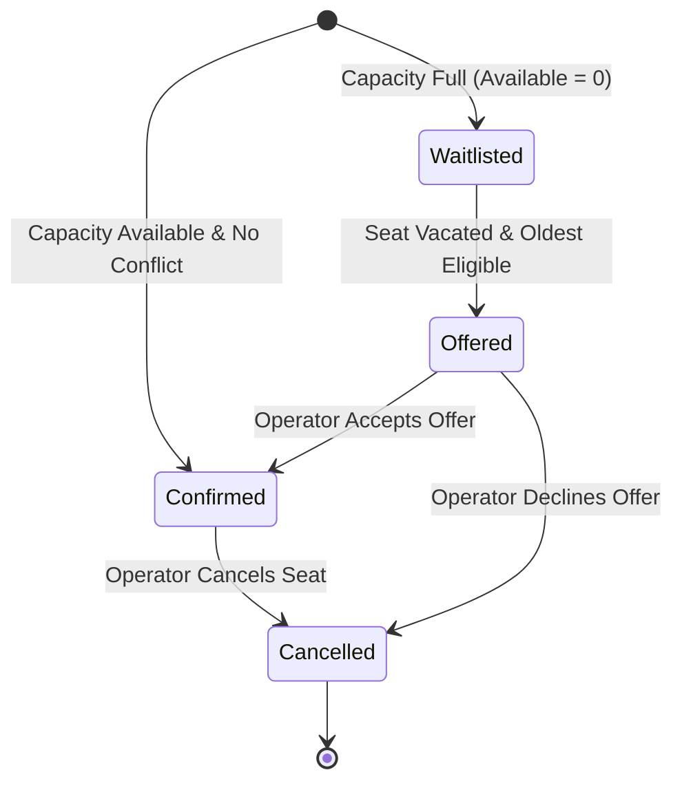

# Business Rules Specification: Training Enrollment Desk

## 1. Core Data Models and Identity Rules

### 1.1 Person Entity & Email Normalization
- A **Person** is uniquely identified by their normalized email address.
- **Email Normalization Rule**:
  $$\text{email}_{\text{normalized}} = \text{email.trim().toLowerCase()}$$
- Examples: `"  John.Doe@Acme.COM  "` $\rightarrow$ `"john.doe@acme.com"`.
- When an enrollment form is submitted:
  - If a person with `email_normalized` already exists in storage, reuse the existing `personId` and update their name/company if newly provided.
  - If no record exists, generate a deterministic unique ID (`PER-{timestamp}-{hash}`) and persist the person.
- A person may be enrolled in multiple training sessions as long as the sessions do not have overlapping schedules.

### 1.2 Company Name Normalization
- Company names are normalized for group discounting:
  $$\text{company}_{\text{normalized}} = \text{company.trim().toLowerCase()}$$
- Examples: `"Acme Corp"`, `" acme corp  "`, `"ACME CORP"` are all treated as the same company entity for discount tallying.

---

## 2. Training Sessions Catalog

The desk manages four fixed training sessions. Their parameters are immutable:

| Session ID | Title | Time Range (24h) | Room | Max Seats | Base Price (INR) |
| :--- | :--- | :--- | :--- | :--- | :--- |
| `SES-HTML` | **HTML and CSS** | 09:00 – 11:00 | Room A | 8 | ₹2,000 |
| `SES-REACT` | **React** | 09:30 – 12:00 | Room B | 6 | ₹4,000 |
| `SES-TEST` | **Testing** | 13:00 – 15:00 | Room A | 6 | ₹3,000 |
| `SES-SYSDES`| **System Design** | 15:30 – 17:30 | Room B | 4 | ₹5,000 |

*Total Aggregate Classroom Capacity across all sessions: 24 seats.*

---

## 3. Session Overlap and Conflict Detection

### 3.1 Overlap Condition
Two sessions $S_1$ and $S_2$ on the same training date overlap if and only if:
$$\text{Start}(S_1) < \text{End}(S_2) \quad \land \quad \text{Start}(S_2) < \text{End}(S_1)$$

### 3.2 Schedule Conflict Matrix
Evaluating all pairs across the catalog:

| Session | HTML & CSS (09:00-11:00) | React (09:30-12:00) | Testing (13:00-15:00) | System Design (15:30-17:30) |
| :--- | :---: | :---: | :---: | :---: |
| **HTML & CSS** | - | **CONFLICT** (09:30–11:00) | No Conflict | No Conflict |
| **React** | **CONFLICT** (09:30–11:00) | - | No Conflict | No Conflict |
| **Testing** | No Conflict | No Conflict | - | No Conflict |
| **System Design** | No Conflict | No Conflict | No Conflict | - |

- **Crucial Rule**: `SES-HTML` and `SES-REACT` directly collide. A participant cannot hold an active seat (`Confirmed` or `Offered`) in both sessions simultaneously.

### 3.3 Conflict Handling Rules
1. **Intra-Submission Conflict**: If a user selects both HTML & CSS and React in a single form submission, submission is blocked with an instant validation error.
2. **Prior-Enrollment Conflict**: If a person already has a `Confirmed` or `Offered` status in session $A$, they cannot enroll as `Confirmed` or be `Offered` in session $B$ if $A$ and $B$ overlap.
3. **Waitlist Exemption**: A person *may* be on the waitlist for a conflicting session, but when a seat is offered, eligibility is rechecked. If they still hold a confirmed seat in the conflicting session, they are skipped in favor of the next candidate.
4. **Conflict Message Format**:
   > *"Session Conflict: You already have a confirmed seat in HTML and CSS (09:00 - 11:00, Room A) which overlaps with React (09:30 - 12:00, Room B)."*

---

## 4. Enrollment States and Seat Capacity Lifecycle

### 4.1 State Definitions
An enrollment record exhibits one of four mutually exclusive statuses:
1. `Confirmed`: Active participant occupying 1 physical seat. Price is calculated and due.
2. `Waitlisted`: Positioned in FIFO queue because capacity is full. Price is $₹0$ (no charge while waiting).
3. `Offered`: A previously vacated seat has been temporarily reserved for this candidate. Reserves 1 physical seat. Pending operator acceptance.
4. `Cancelled`: Participant has withdrawn or declined an offer. Occupies 0 seats.

### 4.2 Capacity Invariant
At all times, for any session $S$:
$$\text{SeatsOccupied}(S) = \text{Count}(\text{Confirmed}) + \text{Count}(\text{Offered})$$
$$\text{SeatsOccupied}(S) \le \text{MaxCapacity}(S)$$
$$\text{AvailableSeats}(S) = \text{MaxCapacity}(S) - \text{SeatsOccupied}(S)$$

*A full session cannot exceed its capacity under any circumstance.*

### 4.3 State Transition Diagram



---

## 5. Cancellation & Waitlist Promotion Workflow

When a `Confirmed` seat in session $S$ is cancelled:
1. The cancelled enrollment status changes to `Cancelled`.
2. The freed seat is **not** immediately opened to general public walk-ins if waitlisted applicants exist.
3. The system queries all `Waitlisted` applicants for session $S$, ordered by `createdAt` ascending (FIFO - oldest first).
4. **Eligibility Check**: For each candidate in order:
   - Does this person currently hold a `Confirmed` or `Offered` seat in another session that conflicts with $S$?
   - If **yes**, candidate is skipped (logged as ineligible due to conflicting schedule) and evaluation moves to the next candidate.
   - If **no**, this candidate is selected.
5. The selected candidate's status transitions from `Waitlisted` to `Offered`.
6. An `offeredAt` timestamp is recorded.
7. This seat remains reserved (`AvailableSeats` does not increment) until the operator resolves the offer.

### 5.1 Offer Acceptance and Decline Rules
- **Accept Offer**:
  - Validates that the seat is still reserved and no conflict has been introduced.
  - Status updates to `Confirmed`.
  - Confirmation timestamp (`confirmedAt`) is set to the current date/time.
  - Price is calculated using the `confirmedAt` date for discount evaluation.
- **Decline Offer**:
  - Status updates to `Cancelled` (or `Declined`).
  - The seat is immediately offered to the next oldest eligible candidate in the waitlist queue.
  - If no more eligible waitlisted candidates exist, the seat becomes open (`AvailableSeats` increments by 1).

---

## 6. Pricing, Discounts, and Recalculations

### 6.1 Base Pricing
Base fee is determined strictly by the session catalog:
- HTML & CSS: ₹2,000
- React: ₹4,000
- Testing: ₹3,000
- System Design: ₹5,000

### 6.2 Early Bird Discount (15%)
- **Condition**: Enrollment confirmation occurs at least 7 full calendar days prior to the session date:
  $$\text{SessionDate} - \text{ReferenceDate} \ge 7 \text{ days}$$
- **Date Reference Rule**:
  - For **immediate confirmation**: $\text{ReferenceDate} = \text{OriginalEnrollmentDate}$.
  - For an **accepted waitlist offer**: $\text{ReferenceDate} = \text{ConfirmationDate}$ (the date the offer was accepted).
  *Rationale*: A waitlisted candidate had no confirmed seat until the offer was accepted; discount reflects availability at the actual point of commitment.
- **Calculation**:
  $$\text{DiscountAmount} = \text{BasePrice} \times 0.15$$
  $$\text{FinalPrice} = \text{BasePrice} - \text{DiscountAmount}$$

### 6.3 Company Discount (10%)
- **Condition**: At least **3 unique people** from the same normalized company (`company_normalized`) hold `Confirmed` status in that specific session:
  $$\text{UniqueConfirmedEmployees}(\text{company}, \text{session}) \ge 3$$
- **Eligibility Exclusions**: Candidates with `Waitlisted`, `Offered`, or `Cancelled` status do **not** count toward the 3-person threshold.
- **Inclusive Counting**: The enrolling person is included in the count when checking if their confirmation achieves the threshold of 3.
- **Calculation**:
  $$\text{DiscountAmount} = \text{BasePrice} \times 0.10$$
  $$\text{FinalPrice} = \text{BasePrice} - \text{DiscountAmount}$$

### 6.4 Discount Precedence & Single-Discount Rule
- **Rule**: Apply **at most one** discount per enrollment.
- **Precedence Hierarchy**:
  1. If eligible for Early Bird (15%) $\rightarrow$ Apply **Early Bird (15%)**.
  2. Else if eligible for Company Discount (10%) $\rightarrow$ Apply **Company Discount (10%)**.
  3. Else $\rightarrow$ **No Discount** (0%).
- **Rationale for Early Bird Priority**:
  - Early Bird offers higher financial savings to the participant (15% vs. 10%).
  - Early Bird rewards early commitment and planning.
  - Avoiding stacking prevents unviable pricing erosion.

### 6.5 Dynamic Company Discount Recalculation
Because the company discount depends on aggregate company enrollment counts:
- **Threshold Reached (Count $2 \rightarrow 3$)**:
  - When a 3rd employee from Acme Corp confirms, the 3rd employee gets the 10% discount (unless already on 15% Early Bird).
  - The previous 2 employees are retroactively re-evaluated: if they were paying full base price, their pricing is recalculated to reflect the 10% company discount.
- **Threshold Broken (Count $3 \rightarrow 2$)**:
  - If 1 of 3 confirmed employees cancels, the count drops below 3.
  - The remaining 2 employees who were receiving the 10% company discount have their discount revoked and revert to Base Price (unless individually eligible for Early Bird on their original enrollment date).

---

## 7. LocalStorage Persistence & Error Recovery

### 7.1 Key Names and Schema Versioning
- Storage key: `training_enrollment_desk_v1`
- Version payload:
  ```json
  {
    "version": 1,
    "lastUpdated": "2026-10-16T18:30:00.000Z",
    "people": [],
    "enrollments": []
  }
  ```

### 7.2 Corrupted or Missing Data Recovery
- **Missing Storage**: If key is not present, hydrate from clean, deterministic seed fixtures.
- **JSON Parse Failure**: Catch syntax errors cleanly without throwing unhandled exceptions. Alert the user and re-seed from default fixtures.
- **Schema Validation Failure**: If parsed data is missing required arrays (`people`, `enrollments`) or contains malformed objects, initiate a graceful reset to seed state.
- **Reset Safety**: An administrative reset button must prompt for explicit confirmation before clearing user data.

---

## 8. Resolution of Requirements Ambiguities

| Ambiguity | Identified Question | Recommended Explicit Decision |
| :--- | :--- | :--- |
| **Waitlisted applicant pricing display** | Does an enrollment form show a fee if the session is full? | Show base price with note: *"Session full - added to waitlist (₹0 charged until confirmed)"*. |
| **Declining an offered seat** | Does a declined candidate go back to waitlist or cancel? | Candidate transitions to `Cancelled` with note `"Offer Declined"`. Prevents endless cycling. |
| **Same person multiple emails** | Can a person bypass the duplicate rule using another email? | The system operates on email identity. Operator training notes specify official corporate email must be used. |
| **Same company name variations** | `"Acme Inc."` vs `"Acme"` | System applies `.trim().toLowerCase()`. Strip standard punctuation (`.` and `,`) during normalization. |
