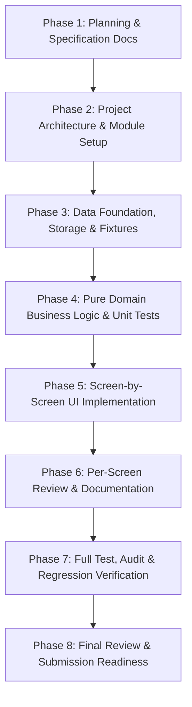

# Project Plan: Training Enrollment Desk

## 1. Project Objective and Scope

### 1.1 Objective
The **Training Enrollment Desk** is a mission-critical, client-side React single-page application (SPA) built for conference and corporate training coordinators. It serves as an interactive administrative operations desk to manage course enrollments, prevent schedule conflicts, enforce strict room capacities, automate waitlist promotions upon cancellations, compute dynamic early-bird and corporate group discounts, and persist operational state reliably across browser sessions using `localStorage`.

This project demonstrates senior-level frontend engineering: modular domain-driven architecture, deterministic state transitions, robust error handling, responsive SaaS UI aesthetics (teal/slate theme), and exhaustive testing.

### 1.2 Scope
- **In Scope**:
  - Full client-side workflow for enrolling participants into 4 fixed training sessions.
  - Schedule collision / time overlap prevention for individuals across sessions.
  - Strict seat capacity enforcement and FIFO waitlist queueing.
  - Seat-offering workflow: automatically reserving a seat for the oldest eligible waitlisted candidate when a confirmed seat is vacated, pending operator acceptance or decline.
  - Transparent pricing engine: 15% Early Bird discount vs. 10% Corporate Group discount (maximum one discount applied, with early bird prioritized).
  - Retroactive and state-change discount recalculations (e.g. when cancellations drop a company below the 3-person threshold).
  - Administrative dashboard, enrollment registration form, session roster management, people registry, and session detail modals.
  - LocalStorage persistence with schema versioning, checksum/schema validation, and safe hydration fallback.
  - Responsive web design supporting desktop, tablet, and mobile breakpoints following the approved UI reference.
- **Out of Scope**:
  - Remote backend server, relational databases, or external microservices (simulated purely via deterministic in-memory domain logic and `localStorage`).
  - Real payment gateway processing (prices and fee statuses are simulated tracking records).
  - External OAuth / SSO providers (a mock client-side operator authentication state is supported for the login screen).

---

## 2. Functional Requirements

### FR-1: Participant Identification & Normalization
- Participants are identified primarily by their email address.
- Email addresses must be strictly normalized: trimmed of leading/trailing whitespace and converted to lower case (`john.doe@acme.com`).
- Company names must be trimmed and normalized (case-insensitive trimming for group discount calculations).
- A single person can be enrolled in multiple non-conflicting sessions.

### FR-2: Fixed Training Catalog
The application governs four concrete training sessions with immutable baseline definitions:
1. **HTML and CSS**: 09:00–11:00, Room A, Capacity: 8 seats, Base Price: ₹2,000.
2. **React**: 09:30–12:00, Room B, Capacity: 6 seats, Base Price: ₹4,000.
3. **Testing**: 13:00–15:00, Room A, Capacity: 6 seats, Base Price: ₹3,000.
4. **System Design**: 15:30–17:30, Room B, Capacity: 4 seats, Base Price: ₹5,000.

### FR-3: Session Overlap & Conflict Detection
- Two sessions overlap if their scheduled time windows intersect:
  $$\text{Start}_A < \text{End}_B \quad \text{and} \quad \text{Start}_B < \text{End}_A$$
- Notice: **HTML and CSS** (09:00–11:00) and **React** (09:30–12:00) directly overlap between 09:30 and 11:00.
- A participant with a `Confirmed` or `Offered` status in one session cannot be enrolled or confirmed in another overlapping session.
- System must provide clear, actionable conflict modal feedback showing the exact conflicting sessions and time slots.

### FR-4: Capacity, Enrollment, & Waitlist Lifecycle
- **Confirmed**: Available capacity exists ($C_{\text{confirmed}} + C_{\text{offered}} < \text{MaxCapacity}$), no schedule conflict, candidate is immediately placed in confirmed roster.
- **Waitlisted**: Session capacity is exhausted. The participant is placed in a chronological FIFO waitlist queue with timestamp. Waitlisted participants are not charged ($₹0$ due).
- **Offered**: When a confirmed enrollment is cancelled, the system identifies the oldest eligible waitlisted candidate (verifying they still have no overlapping confirmed sessions) and transitions them to `Offered`. An offered seat decrements available capacity so it cannot be oversold.
- **Offer Resolution**: Operator can `Accept Offer` (transitions to `Confirmed`, triggers pricing calculation based on confirmation date) or `Decline Offer` (transitions to `Cancelled` or back to waitlist, and offers to the next candidate).
- **Cancelled**: Explicit operator cancellation releases confirmed seats immediately.

### FR-5: Pricing & Discount Engine
- **Base Fee**: Defined per session.
- **Early Bird Discount (15%)**:
  - Eligible if enrollment confirmation occurs at least 7 full calendar days prior to the session date.
  - For immediate confirmations, eligibility is evaluated on the original enrollment date.
  - For waitlist-to-offered-to-confirmed transitions, eligibility is evaluated on the date the offer is accepted (`confirmationDate`).
- **Company Discount (10%)**:
  - Eligible if at least 3 unique individuals from the exact same normalized company are confirmed in the same session.
  - When the 3rd person confirms, the discount applies to the 3rd person and retroactively recalculates for the previous 2 participants from that company.
  - If a cancellation drops the confirmed headcount for a company below 3, the remaining participants lose the company discount, and prices are recalculated.
- **Discount Precedence**:
  - Exactly **one** discount may apply per enrollment.
  - If an enrollment qualifies for both Early Bird (15%) and Company Discount (10%), **Early Bird (15%)** takes precedence because it provides the highest financial benefit to the participant and represents an established commitment.

---

## 3. Non-Functional Requirements

- **Performance**: Instantaneous client-side transitions ($<50\text{ms}$ calculation and render time). Zero jank, optimized React renders without unnecessary effect cascades.
- **Reliability & Data Integrity**: Strict validation prior to persisting to `localStorage`. Corrupted or malformed storage entries are detected via versioning and schema checks, triggering a non-destructive recovery or controlled fallback.
- **Accessibility (a11y)**: WCAG 2.1 AA compliance: accessible color contrast (Teal `#009688`, Dark Slate `#0F172A`, Slate `#64748B`), explicit form labels, ARIA dialog roles, focus management on modals, and keyboard escapable dialogs.
- **Responsiveness**: Fluid layout from mobile ($375\text{px}$) to wide desktop ($1440\text{px}+$); sidebar transforms to mobile header/bottom tabs or drawer.
- **Visual Aesthetics**: Clean SaaS dashboard style, subtle borders (`#E2E8F0`), surface backgrounds (`#FFFFFF`), neutral canvas (`#F8FAFC`), and unambiguous status pill badges.

---

## 4. Screen Inventory and User Workflows

### Screen 1: Dashboard (`/` or `DashboardTab`)
- **Header**: Page title, quick global search bar, date indicator, operator profile avatar.
- **Stat Cards**:
  1. *Total People* (unique participants enrolled or waitlisted across all sessions).
  2. *Confirmed Enrollments* (aggregate active confirmed seats).
  3. *Waitlisted Enrollments* (aggregate candidates awaiting an open seat).
  4. *Available Seats* (remaining open physical capacity across all 4 sessions).
- **Session Capacity & Occupancy Panel**: Visual progress bars per session with occupancy numbers (`6/8 seats`, `5/6 seats`), room tags, and occupancy percentages.
- **Upcoming Sessions Stream**: Quick status cards showing schedule and real-time state.

### Screen 2: Enroll People (`/enroll` or `EnrollTab`)
- **Trainee Details Form**:
  - Full Name (required, trimmed).
  - Email Address (required, trimmed, lowercase converted, validated format).
  - Company (required, trimmed, normalized).
- **Session Selector Checklist**:
  - Displays all 4 sessions with times, rooms, pricing, available seats, and dynamic conflict warnings.
  - Multi-select allows checking multiple sessions in one submission.
- **Selected Sessions Summary Card**:
  - Live side panel computing subtotal, displaying preliminary discount evaluation, and primary CTA: `Check & Enroll`.
- **Conflict Handling**:
  - If a selected session conflicts with an already confirmed session for this person (or within the current selection), blocks submission and triggers the *Session Conflict Dialog*.

### Screen 3: Session Management & Roster (`/sessions` or `SessionsTab`)
- **Session Overview Cards**: Top cards for HTML & CSS, React, Testing, System Design with quick counts of confirmed, waitlisted, and occupancy rate.
- **Toolbar**: Search by trainee name/email/company, filter by session dropdown, filter by status dropdown (`All`, `Confirmed`, `Waitlisted`, `Offered`, `Cancelled`), and `+ New Enrollment` trigger.
- **Enrolled People Roster Table**:
  - Columns: `#`, `Name`, `Email`, `Company`, `Status` (badge), `Enrolled On`, `Calculated Price`, `Actions`.
  - Actions: View Price Breakdown, Accept/Decline Offer (for Offered seats), Cancel Enrollment (with confirmation dialog).
  - Pagination controls.

### Screen 4: Trainee Directory / People (`/people` or `PeopleTab`)
- Summary cards and searchable list of unique individuals.
- Details drawer/view: all sessions associated with that specific email, individual status, total investment/tuition, and aggregate attendance status.

### Screen 5: Operator Sign-In / Demo Auth (`/login`)
- Clean centered modal/page for operator sign-in with email (`admin@training.com`) and password field, validating demo credentials and setting operator session.

### Interaction Dialogs & Feedback:
- **Session Conflict Modal**: Explains exact overlap between target session and existing confirmed session.
- **Price Breakdown Modal**: Shows base price, discount name, applied percentage, deducted amount, and net payable.
- **Waitlist Offer Modal**: Allows operator to approve or decline an offered seat for a waitlisted candidate.
- **Toast Notifications**: Stacked corner notifications with Auto-dismiss for Success, Warning, Error, and Info.

---

## 5. Development Phases and Dependencies

---

## 6. Acceptance Criteria for Each Screen

### AC-1: Dashboard
- Stat cards calculate strictly from live persisted data (no hardcoded totals).
- Capacity bars accurately show $\frac{\text{Confirmed} + \text{Offered}}{\text{Capacity}}$.
- Real-time updates reflect changes immediately upon enrollment or cancellation in other tabs.

### AC-2: Enroll People Form
- Trims whitespace and converts email to lowercase before checking or saving.
- Reuses existing person record if email already exists, otherwise creates new person record.
- Blocks enrollment if the participant already has a Confirmed or Offered seat in a conflicting session.
- If capacity is available, confirms the participant and calculates early-bird/company discount.
- If capacity is full, enrolls participant as `Waitlisted` at $₹0$ charge.
- Triggers success toast upon enrollment with summary of confirmed/waitlisted counts.

### AC-3: Session Management Table
- Accurately filters by session, status, and search query simultaneously.
- Cancelling a confirmed enrollment triggers the automated oldest-waitlist offer promotion.
- Offered status shows explicit `Accept` and `Decline` action triggers.
- Price breakdown button displays exact math including base price, discount rate, and final price.

### AC-4: Modals & Dialogs
- Focus is trapped within modal when opened; Esc key or overlay click dismisses modal.
- Conflict modal highlights specific conflicting session time range.

---

## 7. Risks and Edge Cases

| Risk / Edge Case | Impact | Mitigation Strategy |
| :--- | :--- | :--- |
| **Simultaneous Overlap in Batch Enrollment** | Participant selects both HTML/CSS (09:00-11:00) and React (09:30-12:00) in the same form submission. | Validate intra-batch selections prior to processing; display conflict modal preventing checkout. |
| **Oldest Waitlisted Candidate Has Schedule Conflict** | When a seat frees up, the oldest waitlisted candidate may have subsequently confirmed another conflicting session. | Skip ineligible candidate with an audit log; offer seat to the next oldest *eligible* waitlisted candidate. |
| **Company Discount Collapse via Cancellation** | 3rd person from Acme Corp cancels, dropping company count to 2. | Trigger retroactive price recalculation across all confirmed enrollments for that session upon any status change. |
| **Corrupted or Tampered LocalStorage** | User or extension corrupts `localStorage` JSON syntax or schema. | Encapsulate read in try/catch with schema validation; fallback to clean initial seed fixtures without crashing the app. |
| **Timezone Inconsistencies on Early Bird** | Users in different timezones calculating calendar day differences. | Use UTC/ISO calendar date strings (`YYYY-MM-DD`) and standardized day-difference math (`diff >= 7 days`). |

---

## 8. Definition of Done (DoD)

1. All 5 planning documents completed and verified against business constraints.
2. Architecture strictly separates pure domain logic from React UI and storage services.
3. 100% of business rules (capacity, overlap, FIFO waitlist, offer workflow, discounts) covered by automated tests.
4. UI matches the approved visual design system (Teal `#009688`, Inter typography, responsive layouts, badges, and modals).
5. All interactive buttons, forms, dropdowns, and filters work with zero console errors.
6. Vite production build (`npm run build`) compiles with zero lint or bundling errors.
7. Verification results honestly documented.
