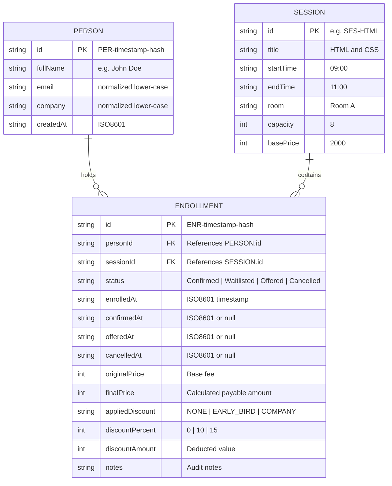
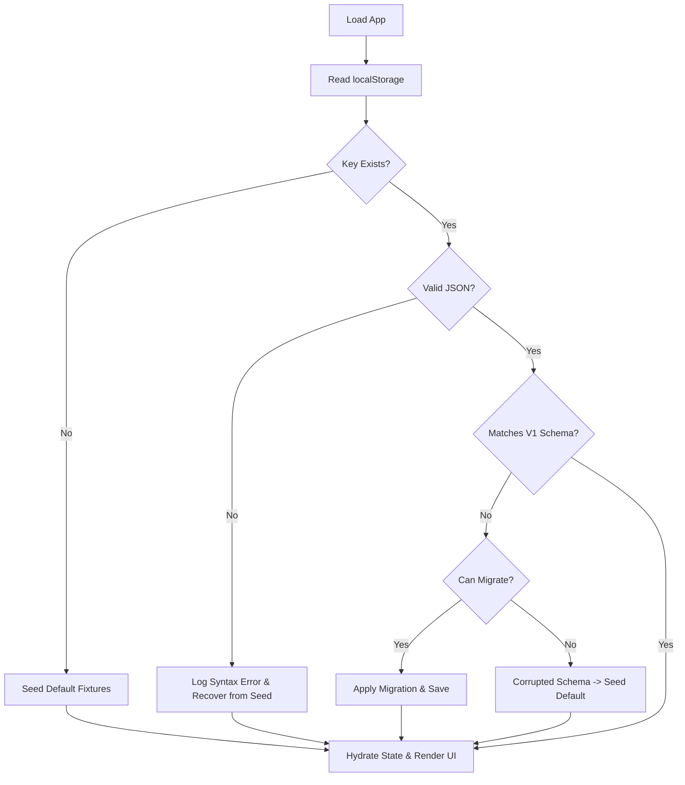

# Technical Architecture: Training Enrollment Desk

## 1. Architectural Philosophy and Overview

The **Training Enrollment Desk** is architected as a modular, client-side React 19 application running on Vite. It strictly decouples **pure domain business rules** from **React presentation components** and **browser persistence services**.

### Core Tenets:
1. **Separation of Concerns**: Pure JavaScript functions handle all business logic (overlap detection, seat capacity checks, discount math, waitlist ordering). React components are strictly view and interaction controllers.
2. **Deterministic Domain Functions**: Domain modules accept plain data arguments and return predictable result objects (`{ success: true, data }` or `{ success: false, error, code }`). They never access `localStorage`, browser APIs, or React hooks directly.
3. **Single Source of Truth for State**: An App-level or Context-level state orchestrator holds hydrated domain state (`people`, `enrollments`, `sessions`) and synchronizes mutations to `localStorage` via a dedicated persistence adapter.
4. **No Heavy External State Libraries**: Modern React state (`useState`, `useReducer`, or shallow React context) is used. No Redux, MobX, or heavy state machines are required.
5. **Progressive Enhancement & Fail-Safe Persistence**: All mutations trigger synchronous or micro-batched persistence. In the event of storage failure, the application remains functional in-memory and alerts the operator.

---

## 2. Directory and Layer Boundaries

```
src/
├── app/
│   ├── App.jsx                     # Root application container & tab router
│   ├── routes.js                   # Tab/view route identifiers
│   └── context/
│       └── EnrollmentContext.jsx   # State coordinator providing domain actions
├── components/
│   ├── ui/                         # Pure design system primitives (no business logic)
│   │   ├── Button.jsx
│   │   ├── Input.jsx
│   │   ├── Select.jsx
│   │   ├── Badge.jsx
│   │   ├── Card.jsx
│   │   ├── Modal.jsx
│   │   ├── ProgressBar.jsx
│   │   └── Tabs.jsx
│   ├── layout/                     # Structural scaffolding
│   │   ├── Header.jsx
│   │   ├── Sidebar.jsx
│   │   └── MobileNav.jsx
│   └── feedback/                   # Alerts, dialogs, notifications
│       ├── ToastContainer.jsx
│       ├── SessionConflictModal.jsx
│       └── PriceBreakdownModal.jsx
├── features/                       # Feature-specific composite screens
│   ├── dashboard/
│   │   ├── DashboardView.jsx
│   │   ├── StatCardsGrid.jsx
│   │   ├── CapacityProgressPanel.jsx
│   │   └── UpcomingSessionsList.jsx
│   ├── enrollment/
│   │   ├── EnrollView.jsx
│   │   ├── TraineeForm.jsx
│   │   ├── SessionChecklist.jsx
│   │   └── SelectedSummaryCard.jsx
│   ├── sessions/
│   │   ├── SessionsView.jsx
│   │   ├── SessionFilterToolbar.jsx
│   │   └── EnrolledPeopleTable.jsx
│   ├── people/
│   │   ├── PeopleView.jsx
│   │   └── PersonDetailDrawer.jsx
│   └── authentication/
│       └── LoginModal.jsx
├── domain/                         # Pure business logic (ZERO React dependencies)
│   ├── sessions/
│   │   ├── sessionDefinitions.js   # Immutable 4 session constants
│   │   └── sessionOverlap.js       # Interval overlap math & conflict diagnostics
│   ├── enrollment/
│   │   ├── enrollmentValidator.js  # Validation rules, email normalization
│   │   └── enrollmentLifecycle.js  # Confirm, waitlist, cancel, capacity guards
│   ├── pricing/
│   │   ├── earlyBirdCalculator.js  # 15% 7-day rule evaluation
│   │   ├── companyDiscount.js      # 10% 3-unique-employee rule
│   │   └── priceBreakdown.js       # Discount precedence & receipt formulation
│   └── waitlist/
│       ├── waitlistQueue.js        # FIFO selection of oldest eligible candidate
│       └── offerLifecycle.js       # Offer reservation, accept, and decline
├── data/                           # Seed fixtures & static constants
│   ├── defaultSessions.js
│   └── seedFixtures.js
├── services/
│   └── storage/
│       ├── localStorageService.js  # Safe getItem/setItem with try/catch
│       ├── schemaValidator.js      # Type and integrity validation
│       └── migrationService.js     # Storage version migration handlers
├── hooks/                          # Reusable non-business React utilities
│   ├── useToast.js
│   ├── useDebounce.js
│   └── useMediaQuery.js
├── utils/                          # Generic helpers (formatting, dates)
│   ├── formatters.js               # Currency (₹), date/time formatters
│   └── dateUtils.js                # Difference in calendar days (UTC-safe)
└── styles/
    └── index.css                   # Tailwind imports & CSS custom properties
```

---

## 3. Data Models and Relationships



---

## 4. State Management Strategy

### 4.1 State Hierarchy
- **Application Core State**:
  - `people`: Array of `Person` objects.
  - `enrollments`: Array of `Enrollment` objects.
  - `sessions`: Array of immutable `Session` objects.
  - `currentDate`: Global simulation date string (defaults to `2026-10-16` or current date) for deterministic early-bird calculations.
  - `activeTab`: Currently visible view (`dashboard`, `enroll`, `sessions`, `people`, `settings`).
  - `currentUser`: Authenticated operator session details.
- **Derived State (Never Stored in Mutable State)**:
  - `totalPeopleCount`: Computed as `people.length` (or unique individuals with non-cancelled enrollments).
  - `confirmedCount`: Filtered `enrollments.filter(e => e.status === 'Confirmed').length`.
  - `waitlistedCount`: Filtered `enrollments.filter(e => e.status === 'Waitlisted').length`.
  - `availableSeatsBySession`: Derived for each session as $\text{capacity} - (\text{confirmed} + \text{offered})$.
  - `activeDiscounts`: Recalculated dynamically from current state upon any enrollment transition.

### 4.2 State Flow Cycle
1. **User Action**: Operator clicks "Enroll", "Cancel", or "Accept Offer".
2. **Domain Invocation**: Action calls a pure domain function with current snapshot.
3. **Result Validation**: If invalid, triggers feedback (conflict modal or toast). If valid, returns next immutable state slices.
4. **React Dispatch**: Context state updates with new arrays.
5. **Persistence Effect**: State changes are serialized to `localStorageService`.
6. **UI Re-render**: Clean re-render of dependent screens.

---

## 5. LocalStorage Schema, Versioning, and Fallback Strategy

### 5.1 Storage Contract
- **Key**: `TRAINING_ENROLLMENT_DESK_DATA`
- **Schema Format (Version 1)**:
  ```json
  {
    "version": 1,
    "lastUpdated": "2026-10-16T18:30:00.000Z",
    "people": [ ... ],
    "enrollments": [ ... ]
  }
  ```

### 5.2 Hydration & Fault-Tolerance Algorithm


---

## 6. Error Handling and Validation Strategy

1. **Form Input Validation**:
   - Client-side validation runs before submission.
   - Email regex: `/^[^\s@]+@[^\s@]+\.[^\s@]+$/`. Whitespace trimmed automatically.
   - Name and Company must have non-empty trimmed strings.
2. **Domain Invariant Enforcement**:
   - Enforce capacity ceiling before confirming.
   - Enforce schedule collision check before confirming or offering.
   - If an invariant violation is attempted, domain function returns a typed rejection:
     ```js
     { success: false, code: 'SESSION_OVERLAP', conflictingSession: { ... } }
     ```
3. **Boundary Protection**:
   - React Error Boundary at root level prevents total blank screen in case of unforeseen runtime exceptions.

---

## 7. Performance and Rendering Strategy

- **Zero Heavy Bundle Overhead**: Vanilla Tailwind CSS + React 19 + standard DOM elements.
- **Derived Value Calculations**: All totals (capacities, revenues, seat counts) are derived in $O(N)$ operations. Since total records in an enrollment desk are in hundreds, calculations complete in $<1\text{ms}$.
- **Stable References**: Pure handlers and callbacks avoid redundant recalculations.
- **No Effect Loops**: Persistence is isolated in a clear event-driven or top-level synchronization listener, preventing state synchronization cascades.

---

## 8. Accessibility and Design Tokens

### 8.1 Color Palette & Token Definitions
Centralized in CSS / Tailwind configuration:
- **Primary Teal**: `#009688` (`text-teal-600`, `bg-teal-600`)
- **Teal Hover**: `#007F76` (`bg-teal-700`)
- **Active Dark Teal**: `#115569` (`bg-teal-800`)
- **Canvas Background**: `#F8FAFC` (`bg-slate-50`)
- **Surface**: `#FFFFFF` (`bg-white`)
- **Borders**: `#E2E8F0` (`border-slate-200`)
- **Primary Typography**: `#0F172A` (`text-slate-900`)
- **Secondary Typography**: `#64748B` (`text-slate-500`)
- **Status Pills**:
  - `Confirmed`: BG `#ECFDF5`, Text `#047857` (Success green)
  - `Waitlisted`: BG `#FFFBEB`, Text `#B45309` (Warning amber)
  - `Offered`: BG `#EFF6FF`, Text `#1D4ED8` (Info blue)
  - `Cancelled`: BG `#FEF2F2`, Text `#B91C1C` (Error rose)

### 8.2 ARIA and Keyboard Navigation
- All dialogs have `role="dialog"`, `aria-modal="true"`, and `aria-labelledby`.
- Modals contain focus traps and listen for the `Escape` key.
- Contrast ratios between text and background exceed 4.5:1.
