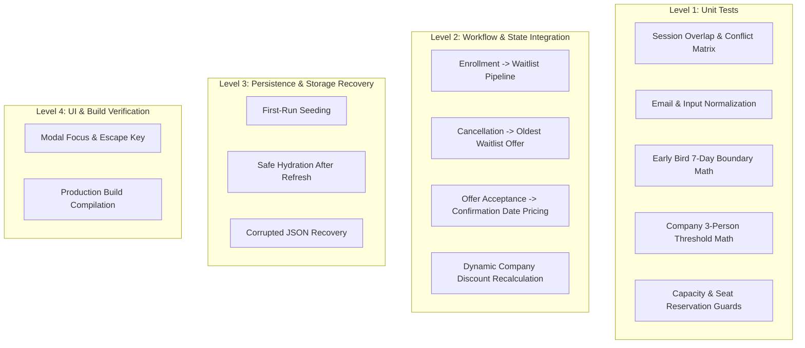

# Test Strategy: Training Enrollment Desk

## 1. Testing Philosophy and Objectives

The primary goal of the **Training Enrollment Desk** test strategy is to provide deterministic confidence that all business rules, seat capacity limits, schedule collision detectors, waitlist FIFO workflows, and pricing calculations operate with mathematical precision.

### Testing Principles:
1. **Domain Isolation**: Pure domain logic functions are tested in complete isolation without mocking React or the DOM.
2. **Realistic Business Scenarios**: Test suites directly simulate actual coordinator actions (e.g., enrolling an applicant, detecting HTML/CSS vs. React overlap, filling a session to capacity, cancelling a seat, offering to the oldest waitlisted candidate, and recalculating company discounts).
3. **Fail-Fast Integrity**: Storage hydration and schema validation are verified against corrupted, missing, and outdated payloads.

---

## 2. Test Architecture and Levels

---

## 3. Pure Business Logic Test Matrix

| ID | Test Suite | Test Case Description | Input Scenario | Expected Outcome |
| :--- | :--- | :--- | :--- | :--- |
| **UT-01** | `sessionOverlap` | Direct overlap: HTML & CSS vs React | $S_1$ (09:00-11:00), $S_2$ (09:30-12:00) | Returns `{ hasConflict: true, overlapDurationMinutes: 90 }`. |
| **UT-02** | `sessionOverlap` | Non-overlapping: HTML & CSS vs Testing | $S_1$ (09:00-11:00), $S_3$ (13:00-15:00) | Returns `{ hasConflict: false }`. |
| **UT-03** | `sessionOverlap` | Boundary case: React vs Testing | $S_2$ ends at 12:00, $S_3$ starts at 13:00 | Returns `{ hasConflict: false }`. |
| **UT-04** | `enrollmentValidator` | Email normalization | `"  Aarav.Sharma@GMAIL.com  "` | Normalized to `"aarav.sharma@gmail.com"`. |
| **UT-05** | `enrollmentValidator` | Company normalization | `"  Acme Corp,  "` | Normalized to `"acme corp"`. |
| **UT-06** | `earlyBirdCalculator` | Exact 7-day boundary | Session: `2026-11-10`, Enrolled: `2026-11-03` | `daysDifference = 7`. Eligible for 15% discount. |
| **UT-07** | `earlyBirdCalculator` | 6-day disqualification | Session: `2026-11-10`, Enrolled: `2026-11-04` | `daysDifference = 6`. Ineligible (0% Early Bird). |
| **UT-08** | `companyDiscount` | Below threshold (2 people) | Company: Acme, 2 confirmed in React | Ineligible for company discount (0%). |
| **UT-09** | `companyDiscount` | Meets threshold (3 people) | Company: Acme, 3 confirmed in React | All 3 qualify for 10% company discount. |
| **UT-10** | `companyDiscount` | Excludes waitlisted & cancelled | 2 confirmed, 1 waitlisted, 1 cancelled | Count of confirmed = 2. Ineligible (0%). |
| **UT-11** | `priceBreakdown` | Discount Precedence: Both qualify | Eligible for 15% Early Bird AND 10% Company | Selects 15% Early Bird. Final price = Base - 15%. |
| **UT-12** | `priceBreakdown` | Waitlisted pricing rule | Status: `Waitlisted` | `finalPrice = 0`, note: `"No charge while waitlisted"`. |

---

## 4. Workflow Integration Scenarios

### Scenario 1: Immediate Capacity Exhaustion and Waitlist Routing
- **Precondition**: Session `SES-SYSDES` (System Design) has capacity 4. Currently 4 confirmed participants.
- **Action**: Participant 5 (`elena@tech.com`) submits enrollment for System Design.
- **Verification**:
  - `AvailableSeats` remains `0`.
  - Participant 5 is created with status `Waitlisted`.
  - `enrolledAt` timestamp recorded.
  - Payable amount is ₹0.
  - Session roster shows 4 confirmed, 1 waitlisted.

### Scenario 2: Cancellation, Oldest Waitlist Promotion, and Schedule Check
- **Precondition**: System Design is full (4 confirmed), Candidate A (waitlisted at 10:00 AM), Candidate B (waitlisted at 10:30 AM).
- **Action**: One confirmed participant in System Design cancels their seat.
- **Verification**:
  - Cancelled participant status transitions to `Cancelled`.
  - Waitlist queue is queried: Candidate A is oldest.
  - Overlap check for Candidate A: has no conflicting confirmed sessions.
  - Candidate A transitions to `Offered`.
  - `AvailableSeats` remains `0` (seat is held for Candidate A).

### Scenario 3: Candidate Ineligibility on Waitlist Promotion
- **Precondition**: React (09:30-12:00) has a vacated seat. Candidate A is oldest waitlisted, but Candidate A has meanwhile confirmed HTML & CSS (09:00-11:00).
- **Action**: Cancellation event processes waitlist promotion.
- **Verification**:
  - Candidate A is identified as conflicting (09:00-11:00 overlaps 09:30-12:00).
  - Candidate A is skipped with an audit log.
  - Candidate B (next oldest) is evaluated and offered the seat.

### Scenario 4: Offer Acceptance and Confirmation Date Pricing
- **Precondition**: Candidate A holds `Offered` seat in React (Session Date: `2026-11-10`).
- **Action**: Coordinator clicks "Accept Offer" on `2026-11-05` (5 days prior to session).
- **Verification**:
  - Status transitions to `Confirmed`.
  - `confirmedAt` is set to `2026-11-05`.
  - Early Bird check evaluates `2026-11-10` minus `2026-11-05` = 5 days $< 7$ days.
  - Candidate A pays full base price ₹4,000 (or Company discount if applicable).
  - Demonstrates that waitlist offers evaluate pricing based on *confirmation date*, not original waitlist date.

### Scenario 5: Retroactive Company Discount Recalculation
- **Precondition**:
  - Trainee 1 (Acme) confirmed React on `2026-11-05` (Price ₹4,000, 0% Early Bird).
  - Trainee 2 (Acme) confirmed React on `2026-11-06` (Price ₹4,000, 0% Early Bird).
- **Action**: Trainee 3 (Acme) confirms React on `2026-11-07`.
- **Verification**:
  - Acme confirmed count reaches 3.
  - Trainee 3 price = ₹3,600 (10% discount).
  - Trainee 1 & 2 are automatically recalculated: ₹4,000 $\rightarrow$ ₹3,600 (10% discount).
- **Subsequent Action**: Trainee 3 cancels.
- **Subsequent Verification**:
  - Acme confirmed count drops to 2.
  - Trainee 1 & 2 are recalculated back to ₹4,000 base fee.

---

## 5. LocalStorage Persistence Test Plan

1. **Cold Start / First-Run**:
   - Clearing `localStorage` triggers automatic initialization with initial seed records.
   - Initial counts match fixtures (e.g. 24 total people, 18 confirmed, 6 waitlisted, 14 available seats).
2. **Reload / Hydration**:
   - Mutating an enrollment (e.g., adding an enrollment or cancelling a seat) writes immediately to storage.
   - Performing browser page reload restores the exact mutated state.
3. **Invalid JSON Injection**:
   - Overwriting storage value with `"{ invalid_json_syntax "` does not throw an uncaught exception.
   - Hydration fallback catches error, logs warning, and restores seed fixtures safely.
4. **Schema Evolution**:
   - Outdated version (`version: 0`) is upgraded to `version: 1` through migration adapter.

---

## 6. UI & Acceptance Verification Checklist

- [ ] All forms trim and lowercase emails before submission.
- [ ] Session checklist dynamically displays remaining available seats.
- [ ] Selecting conflicting sessions prompts the *Session Conflict Dialog*.
- [ ] Price breakdown dialog displays base price, discount name, percentage, and net payable.
- [ ] Toast notifications appear at top-right for success, warning, error, and auto-dismiss after 4 seconds.
- [ ] Production build (`npm run build`) executes cleanly with zero syntax errors, broken imports, or bundle failures.
